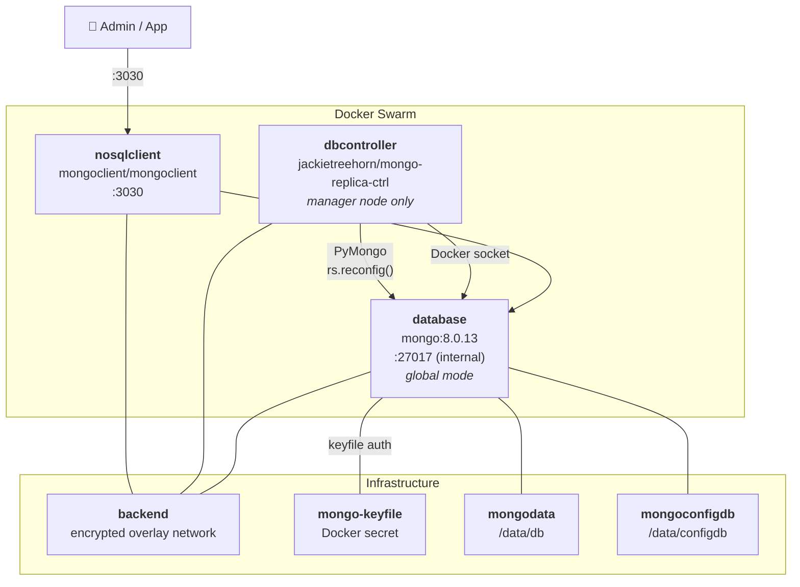

<h1 align="center">
  <code><strong>Things That This Fork Hopes to Add:</strong></code>
</h1>

<p align="center">
  - Allow for external access to Mongo Service without running VPN/etc by using External Horizons w/ rs.Config.
  <br>
  - Add TLS on connections now that they are going outside the SWARM ( I already use an ACME-DNS server and have acme-rsync helpers in my swarms)
  <br>
  - Use Swarm Secrets instead of passwords stored in .Env files
  <br>
  - Possibly use Swarm Config(s) to replace deploy.sh
  <br>
  <br>
 
  <br>
  
  <br>

</p>
<h1 align="center">
  
  
  
  <br>
  <br>
  <code><strong>MongoDB-ReplicaSet-Manager</strong></code>
</h1>

<p align="center">
  
  
  
  
</p>

<p align="center">
  Automated configuration, monitoring, and management of a MongoDB replica set in Docker Swarm.<br>
  Ensures continuous operation and adapts to topology changes for high availability and data consistency.
</p>

> **Read the full write-up:** [Building Production MongoDB Replica Sets in Docker Swarm](https://blog.bitwise0x.com/blog/mongodb-replica-set-manager) — covers architecture decisions, failover benchmarks, and production lessons learned.

---

## Quick Start

```bash
git clone https://github.com/BitWise-0x/MongoDB-ReplicaSet-Manager && cd MongoDB-ReplicaSet-Manager
./deploy.sh
```

<br>

---

## Features

<table>
<tr>
<td valign="top">

### Deployment Intelligence


- **Intelligent Fresh Deployment**: Configures and initiates a replica set from scratch with smart node detection, accounting for `down` or `unavailable` swarm nodes and deployment constraints.
- **Smart Redeployment Detection**: Automatically detects container redeployments with changed IP addresses and immediately updates configuration without unnecessary delays or false initialization attempts.
- **Optimized Performance**: Fast reconfiguration during full redeployments with intelligent primary detection using current task IPs instead of stale configuration data.
- **Advanced Startup Handling**: Robust retry logic handles MongoDB transitional states (`NotYetInitialized`) during startup, distinguishing between temporary states and actual fresh deployments.

</td>
</tr>
<tr>
<td valign="top">

### Runtime Management


- **Primary Node Management**: Automatic primary designation, tracking, and failover handling with intelligent election timeout and forced reconfiguration when needed.
- **Dynamic Scaling**: Real-time addition and removal of MongoDB nodes during runtime with automatic replica set reconfiguration and member management.
- **Comprehensive User Setup**: Automated creation of MongoDB admin (root) accounts and initial application database users with proper authentication and permissions.
- **Continuous Topology Monitoring**: Watches Docker Swarm changes and adjusts replica set configuration for IP changes, node additions/removals, and network topology updates.
- **Production-Ready Logging**: Color-coded ANSI logging with contextual messages, eliminating misleading errors during normal operations.
- **Enterprise Scalability**: Designed for multi-node Docker Swarm environments, tested against various outage scenarios and edge cases for maximum reliability.

</td>
</tr>
</table>

> **Note:** Primary discovery uses MongoDB's `hello` command and checks `isWritablePrimary` for accuracy across server versions.

<br>

---

## Architecture



<br>

---

## Requirements

| Component | Version |
|-----------|---------|
| **MongoDB** | 8.0.x (recipe uses `8.0.13`; 7.0 compatible) |
| **PyMongo Driver** | 4.15.x — pinned `>=4.15,<5`, included in controller image |
| **Docker** | >= `24.0.5` |
| **OS** | Linux >= Ubuntu 23.04 (`linux/amd64`, `linux/arm/v7`, `linux/arm64`) |

<br>

## Prerequisites

- A [Docker Swarm cluster](https://docs.docker.com/engine/swarm/swarm-tutorial/create-swarm/) (local or cloud) — tested on 6-node Swarm
- Docker Stack recipe — see [`docker-compose-stack.yml`](./docker-compose-stack.yml)
- Environment variables — see [`mongo-rs.env`](./mongo-rs.env)
- Deployment script — [`deploy.sh`](./deploy.sh)

<br>

---

## How to Use

1. Set all required environment variables in [`mongo-rs.env`](./mongo-rs.env) (see [Environment Variables](#environment-variables) below).

2. Label each MongoDB Swarm node with its unique positive member number and the shared placement label:

  ```bash
  docker node update --label-add mongo=1 --label-add mongo-member=true <node-1>
  docker node update --label-add mongo=2 --label-add mongo-member=true <node-2>
  docker node update --label-add mongo=3 --label-add mongo-member=true <node-3>
  ```

   Keep `mongo` unique per node. `mongo-member=true` selects the nodes eligible for the global database service.

3. Ensure your global ACME sync/helper service mounts the `acme_rsync_letsencrypt` volume on every MongoDB node. Run [`scripts/build-mongo-pems.sh`](./scripts/build-mongo-pems.sh) on each ACME sync node (or on the ACME server with `MONGO_OUTPUT_DIR` pointed at the volume's `_data/service/mongo` directory). It scans Certbot live certificates for SANs matching `*.db.<environment>.<domain>.<tld>` and writes these files under `/etc/letsencrypt/service/mongo`:

  - `<MONGO_HORIZON_SUFFIX>.pem`: the matching certificate chain followed by its private key, readable by MongoDB's `mongodb` user.
  - `root.pem`: the host CA bundle used to validate MongoDB certificates.

  Since this is a node-local Docker volume, it must exist and contain the synchronized files on every node labeled `mongo-member=true`. The certificate must cover `mongoN.db.<MONGO_HORIZON_SUFFIX>`; a SAN wildcard `*.db.<MONGO_HORIZON_SUFFIX>` covers those names. The stack mounts the volume read-only into MongoDB and the existing controller. When the certificate or CA bundle changes, the controller sends `rotateCertificates` directly to each Mongo task over the overlay and verifies the new certificate is being served; failed rotations retry without restarting the replica task. MongoDB uses TLS for external connections and allows non-TLS connections on the private overlay for existing internal services.

  Example cron entry on each ACME sync node (adjust the install path):

  ```cron
  */5 * * * * /usr/local/sbin/build-mongo-pems.sh >>/var/log/build-mongo-pems.log 2>&1
  ```

  To run it on the ACME server instead, point its output into the volume that gets rsynced to the Swarm nodes:

  ```cron
  */5 * * * * MONGO_OUTPUT_DIR=/var/lib/docker/volumes/acme_rsync_letsencrypt/_data/service/mongo /usr/local/sbin/build-mongo-pems.sh >>/var/log/build-mongo-pems.log 2>&1
  ```

4. Create the DNS A/CNAME records outside the stack so each `mongoN.db.<suffix>` points to the corresponding Swarm node. Ensure TCP port `27017` is reachable only from the intended client networks; the global service publishes that port in host mode on each labeled node.

5. Modify `docker-compose-stack.yml` to include your application service. Use the least-privilege `INITDB_USER` account rather than the Mongo root account, and grant the service the `initdb-password` secret. Configure the application to read `/run/secrets/initdb-password` at startup instead of placing the password in its environment or compose URI. Its internal connection target is `database:27017` with replica set `${REPLICASET_NAME}`.

   External clients should use one of the manually provisioned horizon DNS names with TLS enabled, for example:

  ```
  mongodb://<INITDB_USER>:<url-encoded-app-password>@mongo1.db.${MONGO_HORIZON_SUFFIX}:27017/?replicaSet=${REPLICASET_NAME}&tls=true
  ```

6. Build and publish the updated controller image with [`./build.sh`](./build.sh), or update the controller image reference in `docker-compose-stack.yml` to your own built image. The stack must run an image containing the certificate-rotation code.

7. Deploy via [`./deploy.sh`](./deploy.sh) — this will:
    - Import environment variables
    - Create a `backend` overlay network with encryption enabled
    - Generate the replica-set keyfile as a Docker secret
  - Prompt securely for missing MongoDB passwords and store them as Swarm secrets
    - Spin up all stack services: `mongo`, `dbcontroller`, `nosqlclient`, and your application
    - Run MongoDB in **global** mode only on nodes labeled `mongo-member=true`
    - Configure each member's external horizon as `mongo<mongo-label>.db.<MONGO_HORIZON_SUFFIX>`

8. Monitor logs for output and errors (see [Troubleshooting](#troubleshooting--additional-details)).

9. To remove the stack:

    ```bash
    ./remove.sh
    # or
    docker stack rm [stackname]
    ```

    > The `_backend` overlay network is not removed automatically (it is external). Leave it in place when redeploying to retain the original subnet and avoid connectivity issues.

<br>

---

## Environment Variables

Defined in [`mongo-rs.env`](./mongo-rs.env):

| Variable | Default | Purpose |
|----------|---------|---------|
| `STACK_NAME` | `myapp` | Docker stack name |
| `MONGO_VERSION` | `8.0.13` | MongoDB image tag |
| `MONGO_HORIZON_SUFFIX` | `env.domain.tld` | DNS suffix used to build `mongoN.db.<suffix>` horizon addresses |
| `MONGO_HORIZON_NAME` | `external` | MongoDB horizon key used for TLS clients |
| `REPLICASET_NAME` | `rs` | Replica set name |
| `BACKEND_NETWORK_NAME` | `${STACK_NAME}_backend` | Overlay network name |
| `MONGO_SERVICE_URI` | `${STACK_NAME}_database` | MongoDB service name |
| `MONGO_ROOT_USERNAME` | `root` | Admin username |
| `INITDB_DATABASE` | `myinitdatabase` | Initial database name |
| `INITDB_USER` | `mydbuser` | Initial database user |

Passwords are not stored in `mongo-rs.env`. On first deployment, `deploy.sh` prompts for them without echoing input and creates stack-scoped Swarm secrets. The controller reads the password secret files directly; NoSQLClient's image entrypoint reads its default connection URL from a secret file. Swarm secrets are immutable and persist when the stack is removed, so secret rotation requires creating replacement secrets and updating the stack to reference them.

<br>

---

## How It Works

- **Smart Discovery**: Identifies and assesses MongoDB services in the Docker Swarm with intelligent node state detection and constraint handling.
- **Deployment Intelligence**: Distinguishes between fresh deployments, redeployments with IP changes, and dynamic scaling scenarios using advanced configuration analysis.
- **Optimized Configuration**: Uses current task IPs for primary detection during redeployments, eliminating delays from stale configuration data.
- **Adaptive Management**: Handles MongoDB startup transitional states with retry logic, ensuring reliable operation across various deployment scenarios.
- **Real-time Monitoring**: Continuously adapts replica set configuration for network changes, node lifecycle events, and topology updates with minimal downtime.

The [nosqlclient](https://www.nosqlclient.com/) service included in the recipe provides a web UI at `http://<any-swarm-node-ip>:3030` for browsing and managing the database.

The compose YML pulls the latest controller from DockerHub via [jackietreehorn/mongo-replica-ctrl](https://hub.docker.com/r/jackietreehorn/mongo-replica-ctrl). You can also pull it manually (`docker pull jackietreehorn/mongo-replica-ctrl:latest`) or build locally using the included [`./build.sh`](./build.sh).

<br>

---

## Troubleshooting / Additional Details

### Logs

Check Docker service logs for the `dbcontroller` service. Enable `DEBUG:1` in the compose YML for verbose output. The controller uses **colored ANSI logging**:

| Color | Level |
|-------|-------|
| GREEN | INFO messages |
| YELLOW | WARNING messages and IP addresses |
| RED | ERROR messages |
| MAGENTA (bold) | PRIMARY nodes |
| CYAN | SECONDARY nodes and DEBUG messages |
| BOLD | ReplicaSet-related terms |

```bash
docker service logs [servicename]_dbcontroller --follow
```

Example output:


<br>

### Common Issues

**Environment** — verify all variables are correctly set in [`mongo-rs.env`](./mongo-rs.env).

**Docker Stack Compose YML** — `dbcontroller` must run as a single instance on a Swarm manager node. Multiple instances will perform conflicting actions. A restart policy is included in the service definition for error recovery.

> **IMPORTANT**: The default MongoDB port `27017` is used internally only and is **not** published outside the Swarm by design. Publishing this port will break replica set management.

**Firewalls / SELinux** — Linux distributions using [SELinux](https://www.redhat.com/en/topics/linux/what-is-selinux) are known to cause [issues with MongoDB](https://www.mongodb.com/docs/manual/tutorial/install-mongodb-on-red-hat/). Check with `sestatus` and either disable or [configure it for MongoDB](https://severalnines.com/blog/how-configure-selinux-mongodb-replica-sets/). Also verify your firewall allows MongoDB traffic.

**Networking** — the `_backend` overlay network is assigned an address space automatically by Docker. To define a custom network space, uncomment the relevant section in [`deploy.sh`](./deploy.sh). Do **not** remove this network between redeployments.

**Persistent Data** — the `mongo` service must run in [**global mode**](https://docs.docker.com/compose/compose-file/deploy/#mode) to prevent multiple instances sharing the same data directory. Volumes are defined as external to prevent accidental deletion between redeployments.

**Swarm Nodes** — for HA, run more than one Swarm manager so `dbcontroller` can restart on a different node if needed.

**Healthchecks** — the [mongo-healthcheck](./mongo-healthcheck) script only verifies MongoDB process health (not cluster status). Cluster status is managed by `dbcontroller`. The script is POSIX `sh` compatible and uses `mongosh ping`.

**MongoDB Configuration Check** — run [`./docker-mongodb_config-check.sh`](./docker-mongodb_config-check.sh) from any manager node to fetch `rs.status()` and `rs.config()` output:

```bash
./docker-mongodb_config-check.sh
```

```
members: [
    {
    _id: 1,
    name: '10.0.26.51:27017',
    health: 1,
    state: 2,
    stateStr: 'SECONDARY',
    ...
    },
    {
    _id: 2,
    name: '10.0.26.48:27017',
    health: 1,
    state: 1,
    stateStr: 'PRIMARY',     <--- should match dbcontroller log output
    ...
    }
```

**Service Start-up** — on initial deployment, image downloads and replica set initialization take time. Dependent services (e.g. `nosqlclient`, your application) may fail and restart until MongoDB is ready — this is expected behavior. MongoDB in replica set mode is not available until a primary is elected.

<br>

---

## References & Versioning Notes

- PyMongo driver docs: https://www.mongodb.com/docs/languages/python/pymongo-driver/current/
- PyMongo API docs: https://pymongo.readthedocs.io/en/4.15.1/api/
- Pinned versions:
  - PyMongo: `>=4.15,<5` (compatible with MongoDB 7.x/8.x and Python 3.13)
  - Docker SDK for Python: `>=7,<9`

<br>

---

## Contact

- GitHub: [github.com/BitWise-0x](https://github.com/BitWise-0x)
- DockerHub: [hub.docker.com/u/jackietreehorn](https://hub.docker.com/u/jackietreehorn)

<br>

## License

MIT License — see [LICENSE](LICENSE) for details.
